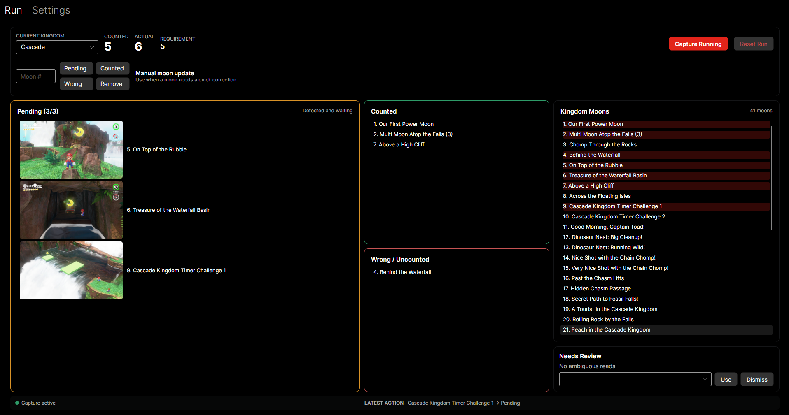

# Aviscribe

Aviscribe is a cross-platform Talkatoo translator for Super Mario Odyssey. English, Traditional Chinese, and Simplified Chinese gameplay are supported, with output being available in all native Super Mario Odyssey languages.

Aviscribe works by capturing gameplay from a camera, capture card, virtual camera, or application window, recognizing Talkatoo and moon collection text, and displaying that info for the user to see.

Aviscribe can also synchronize a run between players through a compatible SMOO+ server. See [Multiplayer with SMOO+](docs/online-runs.md) for setup and usage.

For support, feedback, and to be notified of new builds, join the [Discord server](https://discord.gg/ADDAuJVxjn).

## Supported platforms

- Windows 10/11 x64
- macOS 14+ on Apple Silicon
- Ubuntu 22.04/24.04 x64
- Other modern glibc-based x64 Linux distributions may work

## Installation

Aviscribe is self-contained, so you do not need to install .NET separately.

Download the package for your operating system from the [latest release](https://github.com/xTektonic/Aviscribe/releases/latest).

### Windows

1. Download `Aviscribe-*-win-x64.msi`.
2. Open the installer and follow the prompts. Optionally select **Create a desktop shortcut (all users)** before installing; it is unchecked by default.
3. Leave **Launch Aviscribe** selected on the final page to open it immediately. Aviscribe is also added to the Start menu.

### macOS

1. Download `Aviscribe-*-osx-arm64.dmg`.
2. Open the disk image and drag **Aviscribe** into your Applications folder.
3. Open Aviscribe from Applications.

Because Aviscribe is not currently notarized, macOS may block the first launch. If that happens, open **System Settings > Privacy & Security** and select **Open Anyway** for Aviscribe.

### Linux

Download the AppImage. On most Linux distributions, you can double-click the file to run it. If it does not open, mark it as executable in the file’s **Properties** window, or run:

~~~bash
chmod +x Aviscribe-*-x86_64.AppImage
./Aviscribe-*-x86_64.AppImage
~~~

## Using the application

1. Start Aviscribe and open **Settings > Capture Source**.
2. Select a video device or application window, then start capture.
3. Use **Crop Gameplay** to select the gameplay area when prompted.
4. Configure the run and language, then use the **Run** screen to review pending,
   counted, and uncounted results.

OCR uses WebGPU by default when it is available, which can significantly decrease text and moon recognition times. If WebGPU cannot initialize or fails during processing, Aviscribe automatically falls back to CPU processing. You can explicitly select CPU under **Settings > Setup > OCR processor**.

Capture permissions depend on the platform:

- **Windows:** Allow desktop applications to access cameras.
- **macOS:** Allow Camera and Screen & System Audio Recording access as needed.
- **Linux:** Allow access to `/dev/video*` devices. Capturing Wayland windows
  also requires PipeWire and a working `xdg-desktop-portal` ScreenCast backend.

If a source is not listed after changing permissions or connecting hardware, refresh the source list and restart Aviscribe if necessary.

## Development setup

Aviscribe requires the .NET 10 SDK. The required SDK version is pinned in [global.json](global.json).

This branch consumes the [SMOVision `0.1.0-beta.2` release](https://github.com/xTektonic/SMOVision/releases/tag/v0.1.0-beta.2).
Prepare its nine checksum-pinned packages before restoring:

~~~powershell
./tools/prepare-smovision.ps1
dotnet restore Aviscribe.sln --configfile NuGet.Config
~~~

The script downloads and verifies the exact release archive, then verifies each
package. For an already extracted release, set `SMOVISION_FEED` or pass
`-FromFeed <bundle>/packages`. Packages and a version-specific isolated NuGet cache
are stored under ignored `.local/`; earlier package caches are not reused. No SMOVision
source checkout is required or built. If GitHub access is unavailable, provide the
released packages with `-FromFeed`. Hosted CI access still needs validation.
The beta libraries and vendored replay helper use AGPL-3.0-or-later; see
[dependency notices](docs/dependencies.md).

Build, test, and run the desktop application with:

~~~text
dotnet build Aviscribe.sln --configuration Release --no-restore
dotnet test Aviscribe.sln --configuration Release --no-build
dotnet run --project src/Aviscribe.Desktop
~~~

On Windows, open Aviscribe.sln in Visual Studio and use Aviscribe.Desktop as the startup project if you prefer an IDE workflow.

`Aviscribe.sln` is the main solution for all six application, test, and validation
projects. `Aviscribe.slnLaunch` is an optional Visual Studio desktop launch profile,
not a second solution.

## Validation

Automated tests cover application rules, saved-state compatibility, capture lifecycle,
frame leases, and the SMOVision observation-to-run boundary. Run the package and state
smoke checks after building:

~~~text
dotnet run --project tools/Aviscribe.Validation --configuration Release --no-build -- state-smoke
dotnet run --project tools/Aviscribe.Validation --configuration Release --no-build -- smovision-smoke
~~~

The [replay tool](tools/Aviscribe.Validation/README.md) uses the beta's vendored FFmpeg sample decoder and the
same SMOVision recognition and run projection as live capture. It requires FFmpeg and FFprobe; desktop live
capture does not. See the [integration ledger](docs/smovision-integration-ledger.md)
for integration limitations and validation results.

## Packaging

The packaging scripts use Velopack to produce a Windows x64 MSI, a macOS Apple Silicon DMG, and a Linux x64 AppImage together with the update packages and platform release feeds. Set the version explicitly before packaging:

~~~powershell
./tools/set-version.ps1 1.1.0
~~~

Run the package script on its target operating system:

Capture and OCR native dependencies are supplied by SMOVision packages. Pending-moon
images are embedded in `SMOVision.Assets.dll`; keep that assembly in the published app. The former Aviscribe ScreenCaptureKit bridge is no longer built or shipped.

~~~powershell
./packaging/windows/package.ps1 -Version 1.1.0
~~~

~~~text
bash packaging/macos/package.sh 1.1.0
bash packaging/linux/package.sh 1.1.0
~~~

Packages and publish outputs are written to `artifacts/`. Restore the repository's pinned Velopack tool before running a packaging script directly:

~~~text
dotnet tool restore
~~~

Windows packaging adds an optional desktop-shortcut feature to Velopack's generated MSI. CI checks its default and selected states without installing the application. For unattended installations, pass `AVISCRIBE_DESKTOP_SHORTCUT=1` to `msiexec` to opt in; otherwise no desktop shortcut is created. The Start menu shortcut is always installed. macOS and Linux packaging do not add desktop shortcuts.

macOS signing retains camera and .NET runtime entitlements. Bundle checks verify
SMOVision and OCR assets. macOS capture requires fresh validation: the supplied
SMOVision package uses CoreGraphics, while Aviscribe previously used ScreenCaptureKit.
Porting those recent improvements upstream is tracked in the integration ledger.

Installed copies check the stable GitHub Releases feed whenever Aviscribe starts. Draft and prerelease releases are not offered. When an update is available, Aviscribe asks before downloading it and restarts only after the download completes.

The CI workflow is configured to build and validate all three packages for pull requests. Hosted validation with the SMOVision beta feed remains unverified. A push to `main` creates or refreshes a draft GitHub Release for the version in `Directory.Build.props`; publishing that draft makes the update available. Published releases cannot be replaced; bump the version before creating a new release.

Windows and macOS artifacts are not signed with trusted developer certificates. Windows SmartScreen and macOS Gatekeeper may therefore display warnings.

## Repository layout

- src/Aviscribe.Core: run state, SMOVision integration, and app compatibility models
- src/Aviscribe.UI: Avalonia views and controls
- src/Aviscribe.Desktop: application entry point
- tools/Aviscribe.Validation: state/package smoke checks and SMOVision video replays
- tests: automated tests

The validation tool has its own usage notes in
[tools/Aviscribe.Validation/README.md](tools/Aviscribe.Validation/README.md).

## License

Aviscribe's original source is licensed under the [MIT License](LICENSE). The
SMOVision beta libraries and vendored replay helper are licensed under
**AGPL-3.0-or-later**; see [dependency notes](docs/dependencies.md) for their
license notices and links to the upstream distribution requirements.
